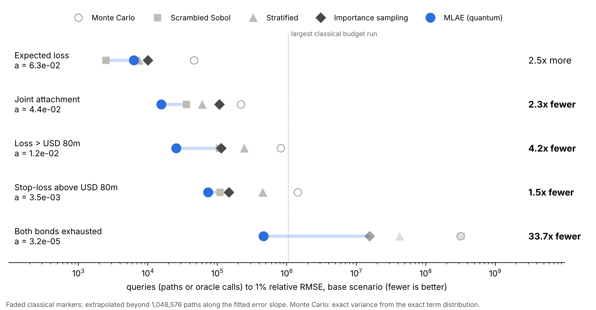
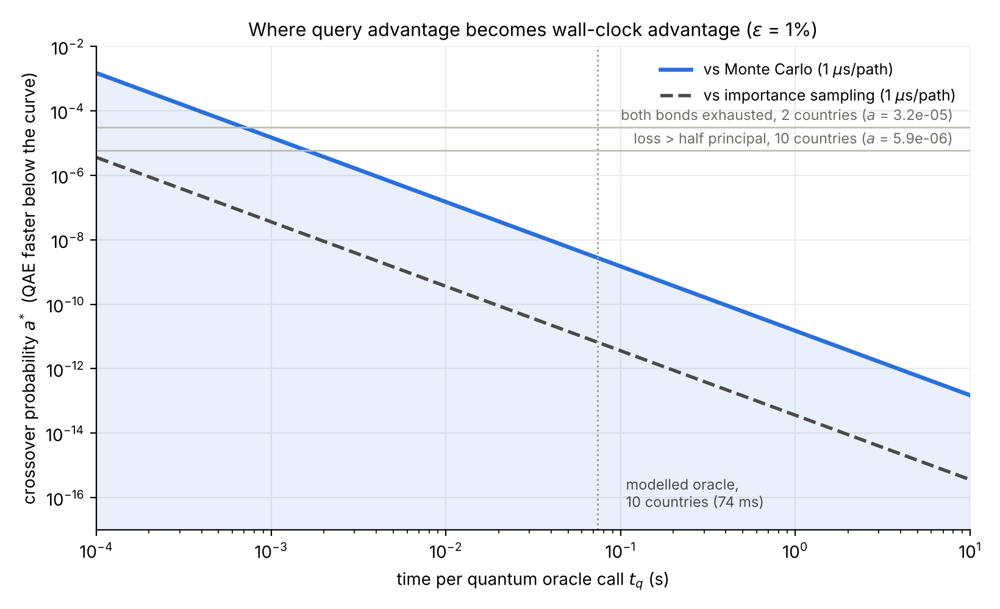

# Grover's Fault

**Team TuringIRL — Phase 1 prototype**

Quantum and tensor-network joint-loss modelling for the Kyrgyz Republic–Tajikistan
Disaster Relief Bond benchmark (brief, Section 3).

## Setup and execution

Requirements: Python >= 3.11 (developed on 3.12.4). Dependencies are only `numpy`, `scipy`, `matplotlib` (+ `pytest`).

```bash
git clone https://github.com/akshitag001/Grover-s-Fault.git
cd Grover-s-Fault
python -m venv .venv && source .venv/bin/activate     # Windows: .venv/Scripts/activate
pip install -r requirements.txt                        # pinned versions (same as requirements.lock)
python -m pytest -q tests                              # 29 tests, ~15 s
./run_all.sh                                           # full reproduction, ~4 min on one CPU core
```

Run one experiment at a time: `python scripts/run_baselines.py`, `run_qae.py`, `run_mps.py`, `run_resources.py`, then `make_figures.py`, `make_fig4.py` and `summary.py`.
All random seeds are fixed in the scripts, so reruns reproduce `results/*.json` exactly.

## Hardware and simulator details

* **No quantum hardware and no cloud/QPU access is used.** Everything runs on a classical CPU.
* **Simulator:** a custom NumPy statevector simulator (`src/adbq/qae.py`), 8 qubits, explicit unitary A. Grover/amplitude-amplification probabilities are checked against it to 1e-14, then used analytically with binomial shot noise for large query counts.
* **Noise:** global depolarising model, visibility (1 - eps)^(420(2k+1)); no device-specific noise model.
* **Tensor network:** exact MPS contraction in NumPy/SciPy, validated against a 5^n CTMC brute force.
* **Reference machine:** Windows 11, Intel Core i5-12450H, 8 GB RAM, Python 3.12.4, NumPy 2.5.3, SciPy 1.18.1. Single-threaded, no GPU needed.
* **Tested in CI:** GitHub Actions (`.github/workflows/tests.yml`) on Ubuntu / Python 3.12.

## Sample results

Committed outputs: `results/SUMMARY.md` (every headline number), `results/*.json` (raw data), `figures/*.png`.

Queries to reach 1% relative RMSE, base scenario (from `results/SUMMARY.md`):

| Target | Best classical | MLAE | Classical / MLAE |
| --- | --- | --- | --- |
| Joint attachment probability | 3.57e+04 | 1.56e+04 | 2.3x |
| Portfolio loss exceedance | 1.06e+05 | 2.56e+04 | 4.2x |
| Both bonds exhausted (p = 3.2e-05) | 1.55e+07 | 4.59e+05 | 33.7x |

Tensor network: matches all 25 Table 5 values to ~1e-14 relative error; a 200-country chain contracts in ~0.2 s.





`run_all.sh` runs the tests, every experiment, the figures, and writes
`results/SUMMARY.md` with every headline number used in the proposal.

## Layout

| Path | What it does |
| --- | --- |
| `src/adbq/model.py` | Exact ADB model: compound Poisson rates, 25-state CTMC, rain law, the brief's 3-year convolution, and the exp(3G) shortcut (structural result 1) |
| `src/adbq/samplers.py` | The brief's four baselines: Monte Carlo, scrambled Sobol (8 scrambles), first-payout-year stratification, half-loss-tilted importance sampling |
| `src/adbq/qae.py` | Track A: explicit 8-qubit unitary A, statevector Grover check, MLAE with doubling / ratio-1.5 schedules, depolarising-noise model |
| `src/adbq/mps.py` | Track B: exact MPS contraction for n-country chains, plus an independent 5^n CTMC brute-force reference |
| `src/adbq/resources.py` | Analytic logical counts for the structured circuit, fault-tolerant footprint and break-even model (all assumptions listed in the module docstring) |
| `scripts/` | One script per experiment; results go to `results/*.json`, figures to `figures/` |
| `requirements.txt` / `.lock` | Pinned environment |
| `tests/` | All 25 Table 5 values, exp(3G) = convolution, Grover probabilities, MPS vs brute force, sampler sanity |

## What is and is not simulated

* QAE runs use exact Grover probabilities (verified against the explicit statevector to 1e-14) with
  binomial shot noise. The 2-country circuit loads the exact term distribution (ideal loading).
* The structured n-country circuit is costed analytically, not compiled or simulated end to end.
* Noise is a global depolarising model: visibility (1 - eps)^(420 (2k + 1)).
* n-country portfolios are synthetic chains built from the Kyrgyz and Tajik tail tables.

## AI use

Code drafted with Claude (Anthropic) under the team's direction; all results come from running this code.
